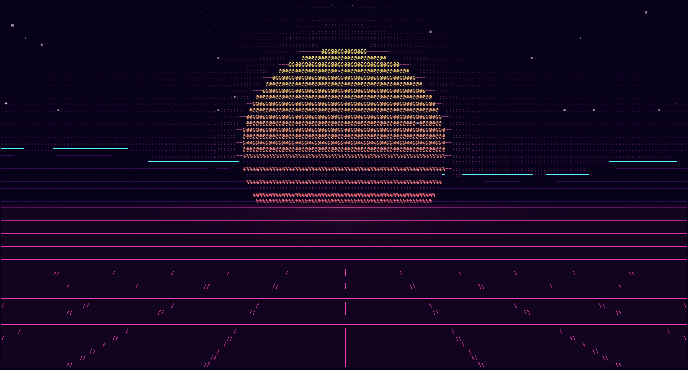
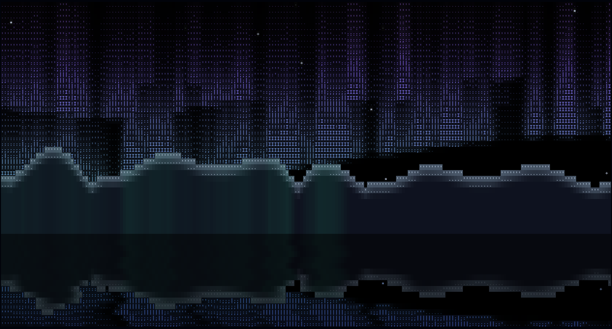

# AsciiPaper

**Wallpapers ASCII animados e interativos para Windows 10/11**, desenhados atrás dos ícones do ambiente de trabalho. Um único `.exe` nativo e pequeno (C++20, Win32, Direct3D 11), sem browser embutido nem runtime pesado. Cada wallpaper é programável e fácil de partilhar.

| synthwave | aurora | aquarium |
|---|---|---|
|  |  |  |
| **valley** | **clock** | **fire** |
|  |  |  |

> **Estado: alpha (v0.5.0).** Fases 0–3 feitas, mais o launcher e o menu da bandeja (parte da Fase 5). Os wallpapers em Lua (fluid, particles, life, clock) chegam na Fase 4. Ver o [roadmap](#roadmap).

## Efeitos incluídos

| Wallpaper | Interação | Variantes |
|---|---|---|
| **synthwave** | pôr do sol retro, sol às riscas, montanhas néon, grelha infinita; o rato move a câmara | `vapor` |
| **aurora** | aurora boreal sobre montanhas e lago; o rato agita as cortinas; clicar lança uma estrela cadente | `crimson` |
| **rain** | janela de noite de chuva com a cidade desfocada; passar/arrastar o rato limpa o vidro embaciado | `neon` |
| **aquarium** | peixes, bolhas, algas e areia; os peixes fogem do rato; clicar deixa cair comida | `abyss` |
| **clock** | relógio grande em blocos, com data em português e barra dos segundos | `amber` (12 h) |
| **fire** | fogo ASCII clássico a subir do fundo de cada ecrã; o rato acende chamas; clicar explode | `spirit` |
| **fireworks** | fogo de artifício sobre a cidade, com rastos; clicar lança um foguete | `gold` |
| **donut** | o donut 3D do terminal, por raymarching; o rato inclina-o; clicar dá-lhe um empurrão | `sprinkles` |
| **valley** | mapa vivo: chuvadas, nuvens com sombra, manadas que fogem do rato, pássaros em V, peixes, aldeias que acendem à noite, ciclo dia/noite; clicar faz cair um relâmpago | `autumn`, `miniature` |
| **ripple** | o rato deixa ondas na água; clicar atira uma pedra; chove de vez em quando | `ember`, `blocks` |
| **matrix** | chuva de caracteres; as colunas desviam-se do cursor | `amber`, `binary` |
| **terrain** | paisagem de ruído a deslizar devagar; o rato faz parallax entre terra e nuvens | `desert`, `topo` |
| **starfield** | voo pelas estrelas; o rato define a direção | `warp`, `braille` |

**Tech demos (v0.5)**: um wallpaper por capacidade do motor, comentados para servirem de exemplo a quem cria os seus (ver `docs/CREATING_WALLPAPERS.md`, secção 6).

| Wallpaper | O que mostra |
|---|---|
| **photo** | a tua imagem, GIF ou vídeo em ASCII a cores, com contornos; lupa no rato (por defeito, o teu wallpaper do Windows) |
| **spectrum** | o som que está a tocar: anel de frequências, barras com picos, ondas de choque na batida |
| **snow** | neve que assenta em cima das janelas, dos ícones e da barra de tarefas, e cai quando as mexes |
| **temple** | cena 3D em tempo real (raymarching) com sombras suaves e nevoeiro; o rato roda a câmara |
| **sandbox** | areia, água e pedra a cair; pintas com o rato (esquerdo areia, direito água, meio pedra) |
| **fluid** | fluido incompressível a sério (24 passos por frame); arrasta-o com o rato |
| **coral** / **life** | reação-difusão (corais e labirintos) e o Jogo da Vida com cor e rastos |
| **fractal** | zoom sem fim no Mandelbrot, a visitar pontos famosos |
| **hud** | hora, CPU, RAM e o tempo lá fora (cidade nas Definições), com brilho de ecrã |
| **planet** | planeta procedural com nuvens, cidades à noite e o Sol da estação do ano real |
| **bonsai** | uma árvore que cresce devagar, diferente cada dia, que muda com as estações |
| **mirror** | tu em ASCII pela webcam (só liga se aceitares); mexe-te e saltam faíscas |
| **terminal** | monitor CRT antigo a escrever citações (edita `quotes.txt`) |
| **arcade** | Breakout que joga sozinho; com o rato no fundo, a raquete é tua |

Temas novos que ligam entradas: `synthwave/beat` (reage à música), `valley/weather` (tempo real), `matrix/code` (o código dos próprios wallpapers).

**Vários monitores = um só efeito.** Com "Estender por todos os monitores" (ligado por defeito), o wallpaper corre numa única tela que cobre todos os ecrãs, como o modo Estender do Windows: uma onda que sai de um monitor entra no outro, os animais do valley atravessam de um ecrã para o outro.

## Menu da bandeja e launcher

| Menu da bandeja | Launcher |
|---|---|
|  |  |

- **Menu da bandeja** (clique no ícone): escolher o wallpaper e a variante, ajustar a velocidade e a resolução da grelha, pausar, abrir o launcher, sair.
- **Launcher** (Personalizar): para cada wallpaper, as variantes, a **resolução da grelha** (tamanho dos caracteres) e a **escala do efeito** (tamanho da paisagem/ondas, independente da resolução), FPS, fonte, cores (com seletor de cor), caracteres e todos os parâmetros próprios. As alterações aparecem ao vivo e ficam guardadas; "Guardar como tema" cria uma variante nova. Também cria wallpapers novos a partir de um modelo e abre o código no teu editor.
- **Definições**: modo estendido, rato só no desktop ou em todo o lado, regras de pausa, limite de FPS, iniciar com o Windows.

A interface segue o tema claro/escuro do Windows e usa como cor de destaque a cor do wallpaper ativo.

## O que a app faz por ti

- Fica **atrás dos ícones** no Windows 10, 11 e 11 24H2+; os ícones continuam clicáveis.
- **Vários monitores**, com DPIs diferentes e em coordenadas negativas. O texto é rasterizado no tamanho exato de cada monitor: nunca fica desfocado.
- **Pausa automática (0% de CPU)** por monitor: jogo ou vídeo em ecrã inteiro, janela maximizada, ecrã bloqueado, suspensão, poupança de bateria.
- **Só reage ao rato quando está sobre o desktop**: clicar num browser não faz ondas.
- Recupera sozinha se o **Explorer** reiniciar ou o **driver da GPU** reiniciar.
- **Ao sair, repõe o wallpaper original** do Windows.

Medido (Release, RTX 4060, 2 monitores, valley a 30 fps): **0,7% de CPU**, GPU 0,19 ms por frame, 0 engasgos com o rato a mexer, ~26 MB de RAM por monitor.

- **FPS do fundo** à tua escolha (automático ou 15–144), no menu da bandeja e nas Definições.
- **O rato não custa nada:** é lido uma vez por frame (sem mensagens por cada movimento) e só conta sobre o ambiente de trabalho; quando sai, os efeitos voltam suavemente ao repouso.
- **Convive com o Wallpaper Engine e o Lively:** ao arrancar pergunta se os pausa (com os comandos deles, sem mexer nas definições) e ao sair pergunta se os retoma.

## Instalar e usar

Na página de [Releases](../../releases) há duas formas, ambas sem permissões de administrador:

**Instalador (recomendado): `AsciiPaper-<versão>-setup.exe`**
1. Corre o instalador. Fica em `%LOCALAPPDATA%\Programs\AsciiPaper`, só para o teu utilizador.
2. Escolhe o que instalar: **completa** (a app e os 28 wallpapers predefinidos) ou **só a app**, sem nenhum wallpaper pronto a usar. Neste caso, o fundo do Windows fica à vista até criares o teu primeiro wallpaper no launcher.
3. Deixa marcado **Iniciar o AsciiPaper com o Windows** se o quiseres sempre ligado. Podes mudar isto depois nas Definições.
4. No fim, o launcher abre. O atalho do Menu Iniciar também o abre, mesmo com a app já a correr.

Para desinstalar: Definições do Windows › Aplicações. A app é fechada primeiro e o teu wallpaper original volta. As tuas definições e os wallpapers que criaste só são apagados se disseres que sim.

**Portátil: `AsciiPaper-<versão>-win64.zip`**
1. Extrai o zip para uma pasta e corre `asciipaper.exe`.
2. Para arrancar com o Windows, liga a opção nas Definições do launcher.

Em ambos os casos, o ícone aparece na área de notificação (junto ao relógio, talvez escondido na seta **^**). Clica nele para escolher o wallpaper, pausar, abrir o launcher ou sair. Ao sair, o teu wallpaper original volta.

O Windows SmartScreen pode avisar ("O Windows protegeu o PC"), porque o executável ainda não está assinado: **Mais informações › Executar mesmo assim**. O `SHA256SUMS.txt` da release serve para confirmar que o ficheiro não foi alterado (`Get-FileHash <ficheiro>`).

### Linha de comandos

| Opção | Descrição |
|---|---|
| `--windowed` | Renderiza numa janela normal (para desenvolver sem mexer no desktop) |
| `--wallpaper <nome ou pasta>` | Usa um wallpaper (`ripple`, uma pasta, ou um tema `.toml`) |
| `--bench <segundos>` | Mede frame time médio/p99, CPU e RAM e sai |
| `--screenshot <ficheiro.png>` | Renderiza 3 s fora do ecrã, grava um PNG e sai |
| `--launcher` | Abre o launcher ao arrancar |
| `--verbose`, `-v` | Logs detalhados, também na consola |
| `--help`, `-h` | Ajuda |

### Ficheiros

| Onde | O quê |
|---|---|
| `%APPDATA%\AsciiPaper\config.toml` | wallpaper escolhido, `interaction`, `max_fps`, `span_monitors`, regras de pausa (o launcher escreve-o por ti) |
| `%APPDATA%\AsciiPaper\overrides\` | os teus ajustes por wallpaper (cores, resolução, parâmetros...), no formato de tema |
| `%APPDATA%\AsciiPaper\wallpapers\` | os teus wallpapers (além dos que vêm ao lado do `.exe`) |
| `%APPDATA%\AsciiPaper\log.txt` | log (roda acima de 1 MB) |

## Criar o teu wallpaper

Uma pasta com um `wallpaper.toml` e um `main.hlsl` de poucas linhas:

```hlsl
CellOut cell(CellIn i)
{
    float d = length(i.world - mouse.world); // unidades de mundo: não dependem da resolução
    float v = sin(d * 0.5 - time * 3.0 * param("speed")) * exp(-d * 0.03);
    CellOut o;
    o.value = v * 0.5 + 0.5;    // escolhe o caractere
    o.fg = palette(o.value);    // e a cor
    o.bg = float4(0, 0, 0, 0);
    o.state = float4(0, 0, 0, 0);
    o.glyph = 0;
    return o;
}
```

Guia completo, com a API toda e temas sem código: **[docs/CREATING_WALLPAPERS.md](docs/CREATING_WALLPAPERS.md)**. O mais fácil é o launcher → **Novo wallpaper**: escolhe um modelo, dá-lhe um nome e o código abre no teu editor; cada gravação aparece logo no ambiente de trabalho.

## Compilar a partir do código

Requisitos: **Windows 10/11 x64**, **Visual Studio 2022** com o workload *Desenvolvimento para desktop com C++* (MSVC v143 + Windows SDK) e **Git**.

```powershell
# 1. Ferramentas (CMake, Ninja, vcpkg) numa pasta do utilizador, sem admin
pwsh scripts/setup.ps1

# 2. Configurar, compilar e testar (Release por defeito)
pwsh scripts/build.ps1

# 3. Correr numa janela, com logs na consola
build\msvc\Release\asciipaper.exe --windowed --verbose

# 4. Criar a release em dist/: zip portátil, instalador (com o Inno Setup 6 instalado) e SHA256SUMS.txt
pwsh scripts/package.ps1
```

O instalador é descrito em [`installer/AsciiPaper.iss`](installer/AsciiPaper.iss) (Inno Setup 6: `winget install JRSoftware.InnoSetup`). No GitHub, criar uma tag `vX.Y.Z` igual à versão do `CMakeLists.txt` compila, testa e prepara uma release em rascunho com estes ficheiros (`.github/workflows/release.yml`).

Com CMake ≥ 3.25 e vcpkg já instalados, basta definir `VCPKG_ROOT` e usar os presets (`cmake --preset msvc`, `cmake --build --preset msvc-release`, `ctest --preset msvc-release`). As dependências (`wil`, `tomlplusplus`, `doctest`) vêm do vcpkg em modo manifest, compiladas estaticamente.

## Documentação

- [`PROJECT.md`](PROJECT.md) — a especificação completa (requisitos, formato dos wallpapers, fases, checklist de testes).
- [`docs/ARCHITECTURE.md`](docs/ARCHITECTURE.md) — como funciona por dentro e porquê: WorkerW, flip model, atlas de glifos, compute shader, DPI, pausas, loop sem polling.
- [`docs/CREATING_WALLPAPERS.md`](docs/CREATING_WALLPAPERS.md) — criar wallpapers e temas.
- [`CHANGELOG.md`](CHANGELOG.md) — histórico de versões.

## Roadmap

| Fase | Conteúdo | Estado |
|---|---|---|
| 0 — Esqueleto | CMake + vcpkg, manifesto PerMonitorV2, ícone, log, instância única, doctest | ✅ |
| 1 — Integração com o desktop | WorkerW (dois layouts), janela por monitor, D3D11 flip, DPI/monitores, reattach, pausas, repor wallpaper | ✅ código · ⏳ checklist manual |
| 2 — Render ASCII | GlyphAtlas (DirectWrite), cell buffer, `grid.hlsl`, blocos/caixa/Braille procedurais, `--bench` | ✅ · ⏳ teste a 200% |
| 3 — Input + backend shader | Raw Input, DesktopHitTest, `prelude.hlsl`, `prev()`, params, manifest TOML, hot reload, erros no ecrã; `ripple`, `matrix`, `terrain`, `starfield` | ✅ · ⏳ teste com o rato no desktop |
| 4 — Backend script | LuaJIT com sandbox, natives (fluid, particles, life); `fluid`, `particles`, `life`, `clock` | ⏳ |
| 5 — App e polimento | Menu da bandeja próprio, launcher (personalizar, criar, editar), temas, autostart, efeito estendido entre monitores | 🟡 grande parte feita · falta wallpaper diferente por monitor |

## Licença

[MIT](LICENSE).
