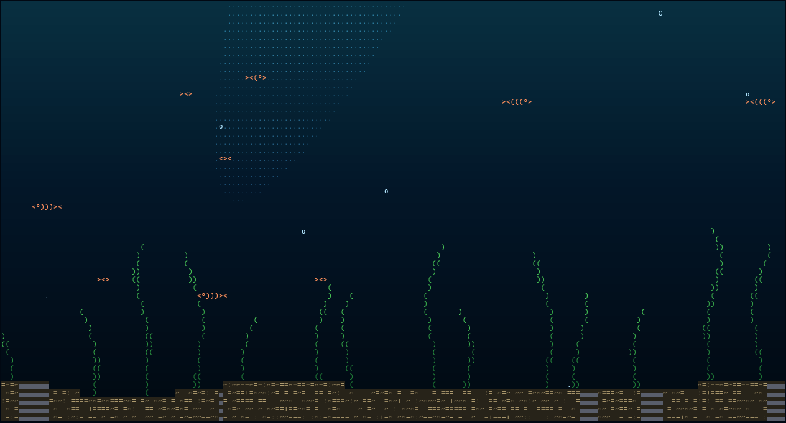
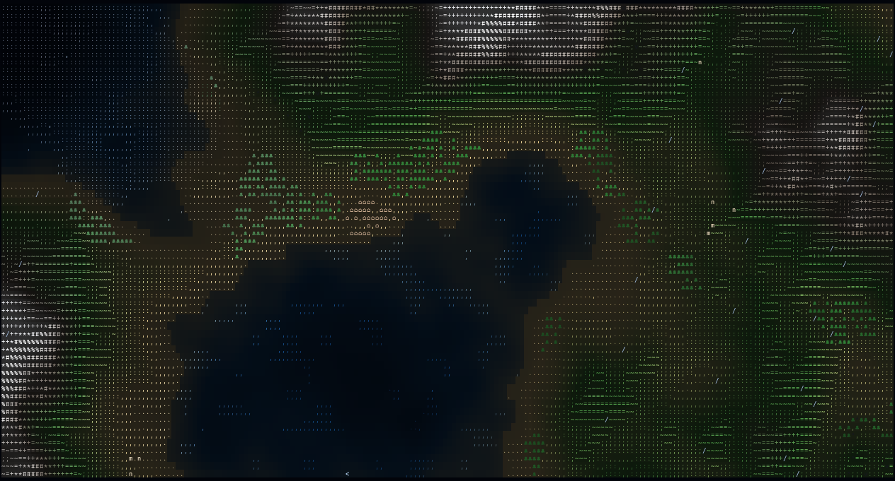
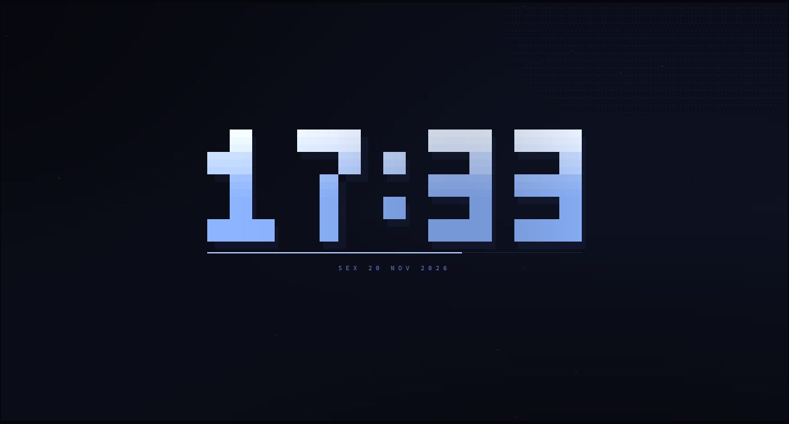
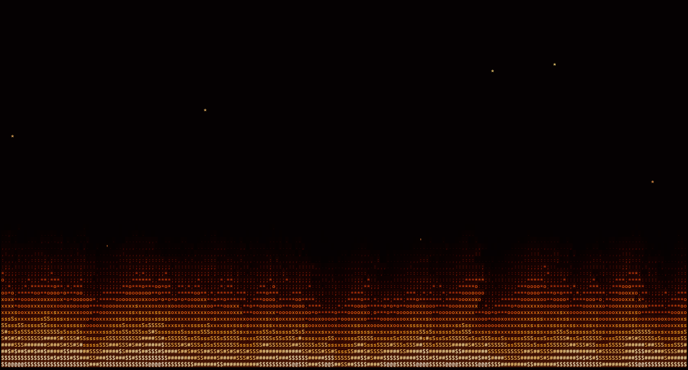
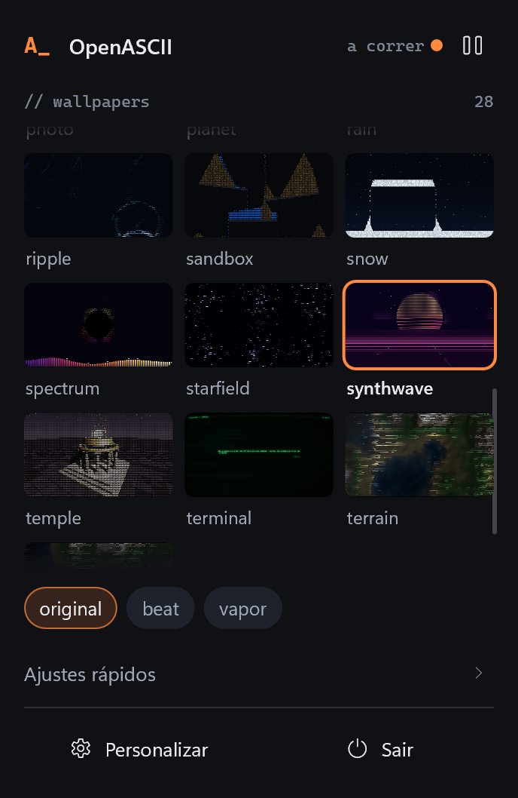
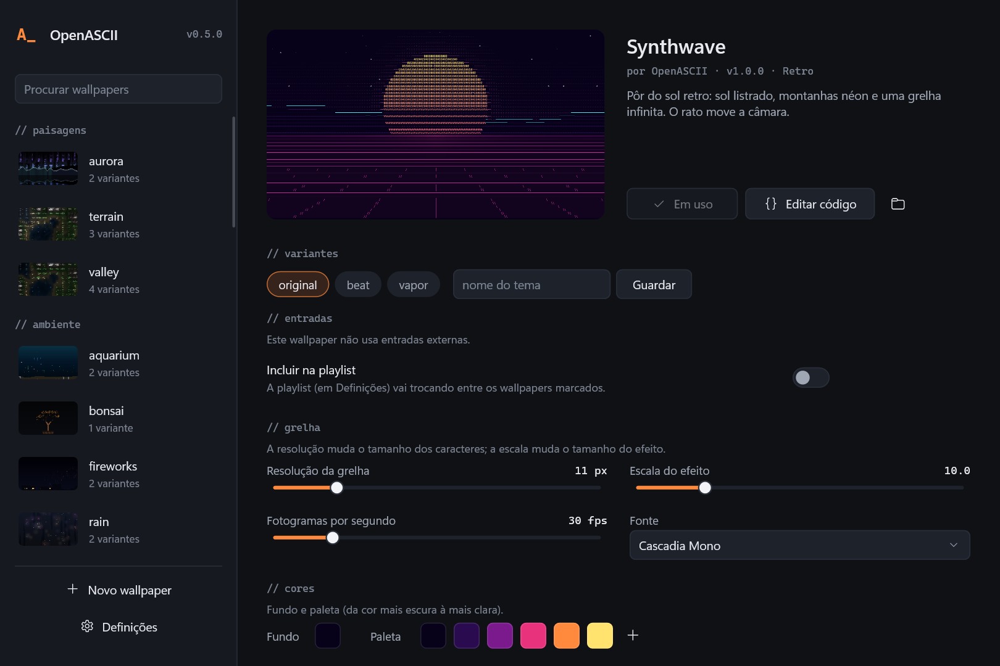

# OpenASCII

***English** · [Português](README.pt.md)*

**Animated, interactive ASCII wallpapers for Windows 10/11**, drawn behind your desktop icons. A single small native `.exe` (C++20, Win32, Direct3D 11), with no embedded browser and no heavy runtime. Every wallpaper is programmable and easy to share. The app speaks English and Portuguese.

| synthwave | aurora | aquarium |
|---|---|---|
|  |  |  |
| **valley** | **clock** | **fire** |
|  |  |  |

> **Status: alpha.** The engine, 28 wallpapers, the launcher, the tray menu and the installer are done. Wallpapers scripted in Lua will come in a future version. See the [roadmap](#roadmap).

## Included wallpapers

| Wallpaper | Interaction | Variants |
|---|---|---|
| **synthwave** | retro sunset, striped sun, neon mountains, endless grid; the mouse moves the camera | `vapor`, `beat` |
| **aurora** | northern lights over mountains and a lake; the mouse stirs the curtains; click for a shooting star | `crimson` |
| **rain** | a rainy night through a fogged-up window; drag the mouse to draw on the glass | `neon` |
| **aquarium** | fish, bubbles, seaweed and sand; fish swim away from the mouse; click to drop food | `abyss` |
| **clock** | a big block clock with the date and a seconds bar | `amber` (12 h) |
| **fire** | classic ASCII fire rising from the bottom of each screen; the mouse lights flames; click to explode | `spirit` |
| **fireworks** | fireworks over the city, with trails; click to launch one | `gold` |
| **donut** | the spinning 3D terminal donut, raymarched; the mouse tilts it; click to push it | `sprinkles` |
| **valley** | a living map: rain, clouds with shadows, herds fleeing the mouse, birds, fish, villages lighting up at night, day/night cycle; click for lightning | `autumn`, `miniature`, `weather` |
| **ripple** | the mouse leaves ripples on the water; click to throw a stone | `ember`, `blocks` |
| **matrix** | character rain; the columns avoid the cursor | `amber`, `binary`, `code` |
| **terrain** | a slowly sliding noise landscape; the mouse adds parallax | `desert`, `topo` |
| **starfield** | flying through the stars; the mouse sets the direction | `warp`, `braille` |

**Tech demos**: one wallpaper per engine feature, commented so they work as examples for your own (see `docs/CREATING_WALLPAPERS.md`, section 6).

| Wallpaper | What it shows |
|---|---|
| **photo** | your image, GIF or video in color ASCII with outlines; a magnifier under the mouse |
| **spectrum** | the sound playing on your PC: frequency ring, bars with peaks, shock waves on every beat |
| **snow** | snow that settles on your windows, icons and taskbar, and falls when you move them |
| **temple** | a real-time 3D scene (raymarching) with soft shadows and fog; the mouse turns the camera |
| **sandbox** | falling sand, water and stone you paint with the mouse |
| **fluid** | a real incompressible fluid (24 steps per frame); drag it with the mouse |
| **coral** / **life** | reaction-diffusion (coral and mazes) and the Game of Life with color and trails |
| **fractal** | an endless zoom into the Mandelbrot set |
| **hud** | time, CPU, RAM and the weather outside (city in Settings) |
| **planet** | a procedural planet with clouds, cities at night and the Sun of the real season |
| **bonsai** | a tree that grows slowly, different every day, changing with the seasons |
| **mirror** | you in ASCII from the webcam (only if you allow it) |
| **terminal** | an old CRT monitor typing quotes (edit `quotes.txt`) |
| **arcade** | a Breakout that plays itself; with the mouse on the desktop, the paddle is yours |

**Many monitors, one effect.** With "Span across all monitors" (on by default) the wallpaper runs on one canvas covering every screen, like Windows' Extend mode: a wave leaving one monitor enters the next.

**Or a different wallpaper on each monitor.** On a wallpaper's page, under "monitors", pick the screens that get it just for them; the others keep the main one. Monitors are recognized by the device, so your choice survives Windows renumbering the screens.

## Tray menu and launcher

| Tray menu | Launcher |
|---|---|
|  |  |

- **Tray icon**: left-click for a short menu (open OpenASCII, pause, quit); right-click for the full tray menu: pick the wallpaper and variant, adjust speed and grid resolution, pause, open the launcher, quit.
- **Launcher** (Customize): for each wallpaper, the variants, **grid resolution** (character size) and **effect scale**, FPS, font, colors, characters, screen effects (CRT, neon, cinema) and all its own parameters, live. "Save as theme" creates a new variant. Right-click a wallpaper to apply it, edit its code, open its folder or delete it (only the ones you created; it always asks first). You can also create new wallpapers from a template, which opens the code in your editor.
- **Settings**: language, monitors and mouse, pause rules, FPS, start with Windows, wallpaper inputs, playlist, other wallpaper apps.

The interface follows Windows' light/dark theme and uses the active wallpaper's color as its accent.

## What the app does for you

- Stays **behind the icons** on Windows 10, 11 and 11 24H2+; icons stay clickable.
- **Multiple monitors** with different DPIs and negative coordinates; text is rasterized at each monitor's exact size, never blurry.
- **Automatic pause (0% CPU)** per monitor: fullscreen game or video, maximized window, locked screen, sleep, battery saver.
- **Only reacts to the mouse over the desktop**: clicking in a browser doesn't make ripples.
- Recovers by itself if **Explorer** or the **GPU driver** restarts, and puts itself back on top if Windows Spotlight reshuffles the desktop.
- **Restores your original wallpaper** when it quits.
- **Gets along with Wallpaper Engine and Lively**: it can pause them while it runs and resume them when it quits.

Measured (Release, RTX 4060, 2 monitors, valley at 30 fps): **0.7% CPU**, 0.19 ms of GPU per frame, ~26 MB of RAM per monitor.

## Install and use

The [Releases](../../releases) page has two options, neither needs admin rights:

**Installer (recommended): `OpenASCII-<version>-setup.exe`**
1. Run it. It installs to `%LOCALAPPDATA%\Programs\OpenASCII`, just for your user.
2. Choose **full** (the app and the 28 built-in wallpapers) or **app only** (no wallpapers; your Windows background stays visible until you create one).
3. Leave **Start OpenASCII with Windows** checked if you want it always on. You can change it later in Settings.
4. At the end the launcher opens. The Start menu shortcut opens it too, even while the app is running.

To uninstall: Windows Settings › Apps. The app is closed first and your original wallpaper comes back. Your settings and the wallpapers you created are only deleted if you say so.

**Portable: `OpenASCII-<version>-win64.zip`**: extract it and run `openascii.exe`; turn on starting with Windows in Settings.

On first launch the app asks for the **language** (English or Portuguese) and then shows **first steps**: performance (FPS, pauses, multiple monitors) and starting with Windows. **Fast start** uses a per-user scheduled task instead of the Windows startup list, which delays apps by a few seconds. No app can start before you sign in, but when the PC is locked OpenASCII stays open, paused, so the wallpaper is already there when you unlock.

Windows SmartScreen may warn ("Windows protected your PC") because the executable isn't signed yet: **More info › Run anyway**. The release's `SHA256SUMS.txt` lets you check the files (`Get-FileHash <file>`).

### Command line

| Option | Description |
|---|---|
| `--windowed` | Render in a normal window (to develop without touching the desktop) |
| `--wallpaper <name or folder>` | Use a wallpaper (`ripple`, a folder, or a `.toml` theme) |
| `--bench <seconds>` | Measure average/p99 frame time, CPU and RAM, then quit |
| `--screenshot <file.png>` | Render 3 s off-screen, save a PNG and quit |
| `--launcher` | Open the launcher on start |
| `--lang <pt\|en>` | Force the interface language (for tests and screenshots) |
| `--work-inset <px>` | With `--windowed`: simulate a taskbar of `<px>` at the bottom |
| `--verbose`, `-v` | Detailed logs, also in the console |
| `--help`, `-h` | Help |

### Files

| Where | What |
|---|---|
| `%APPDATA%\OpenASCII\config.toml` | chosen wallpaper, language, per-monitor wallpapers, pause rules... (the launcher writes it for you) |
| `%APPDATA%\OpenASCII\overrides\` | your per-wallpaper tweaks (colors, resolution, parameters...), in theme format |
| `%APPDATA%\OpenASCII\wallpapers\` | your own wallpapers (besides the ones next to the `.exe`) |
| `%APPDATA%\OpenASCII\log.txt` | log (rotates above 1 MB) |

## Create your own wallpaper

A folder with a `wallpaper.toml` and a short `main.hlsl`:

```hlsl
CellOut cell(CellIn i)
{
    float d = length(i.world - mouse.world); // world units: independent of resolution
    float v = sin(d * 0.5 - time * 3.0 * param("speed")) * exp(-d * 0.03);
    CellOut o;
    o.value = v * 0.5 + 0.5;    // picks the character
    o.fg = palette(o.value);    // and the color
    o.bg = float4(0, 0, 0, 0);
    o.state = float4(0, 0, 0, 0);
    o.glyph = 0;
    return o;
}
```

The easiest way is the launcher's **New wallpaper**: the blank template shows a simple text with five effects in comments that you turn on by deleting the `//` (they stack). Every save shows up on the desktop right away. Full guide (in Portuguese for now): **[docs/CREATING_WALLPAPERS.md](docs/CREATING_WALLPAPERS.md)**.

## Build from source

Requirements: **Windows 10/11 x64**, **Visual Studio 2022** with the *Desktop development with C++* workload (MSVC v143 + Windows SDK) and **Git**.

```powershell
# 0. The code
git clone https://github.com/victorkloh/openASCII.git
cd openASCII

# 1. Tools (CMake, Ninja, vcpkg) in a user folder, no admin
pwsh scripts/setup.ps1

# 2. Configure, build and test (Release by default)
pwsh scripts/build.ps1

# 3. Run in a window, with logs in the console
build\msvc\Release\openascii.exe --windowed --verbose

# 4. Build the release in dist/: portable zip, installer (with Inno Setup 6) and SHA256SUMS.txt
pwsh scripts/package.ps1
```

The installer is described in [`installer/OpenASCII.iss`](installer/OpenASCII.iss). On GitHub, pushing a `vX.Y.Z` tag matching the version in `CMakeLists.txt` builds, tests and prepares a draft release (`.github/workflows/release.yml`).

**Translations**: interface texts go through `tr()` with the Portuguese text as the key; English is in [`src/ui/lang/en.inc`](src/ui/lang/en.inc). Adding a language means adding a table and one line in `src/ui/I18n.cpp`. Wallpapers can have `description_<code>` in their `[meta]`.

## Documentation

The project documentation is in Portuguese for now:

- [`PROJECT.md`](PROJECT.md): the full specification.
- [`docs/ARCHITECTURE.md`](docs/ARCHITECTURE.md): how it works inside and why.
- [`docs/CREATING_WALLPAPERS.md`](docs/CREATING_WALLPAPERS.md): creating wallpapers and themes.
- [`CHANGELOG.md`](CHANGELOG.md): version history.

## Roadmap

| Phase | Content | Status |
|---|---|---|
| 0 — Skeleton | CMake + vcpkg, PerMonitorV2 manifest, icon, log, single instance, doctest | ✅ |
| 1 — Desktop integration | WorkerW (both layouts), one window per monitor, D3D11 flip, DPI/monitors, reattach, pauses, restore wallpaper | ✅ |
| 2 — ASCII rendering | GlyphAtlas (DirectWrite), cell buffer, procedural blocks/box/Braille, `--bench` | ✅ |
| 3 — Input + shader backend | prelude, `prev()`, params, TOML manifest, hot reload, on-screen errors | ✅ |
| 4 — Script backend | LuaJIT with sandbox and natives | ⏳ |
| 5 — App and polish | Tray menu, launcher, themes, autostart, span across monitors, different wallpaper per monitor, languages | ✅ |

## License

[MIT](LICENSE).
