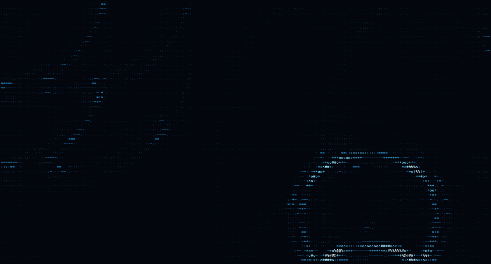
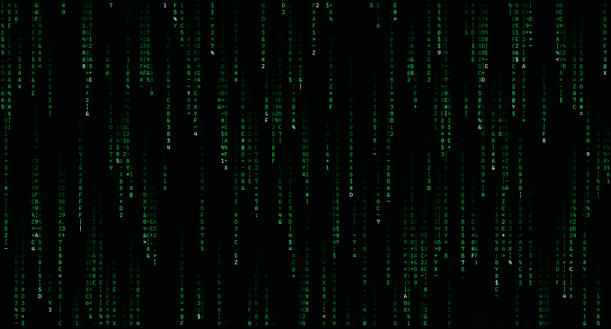
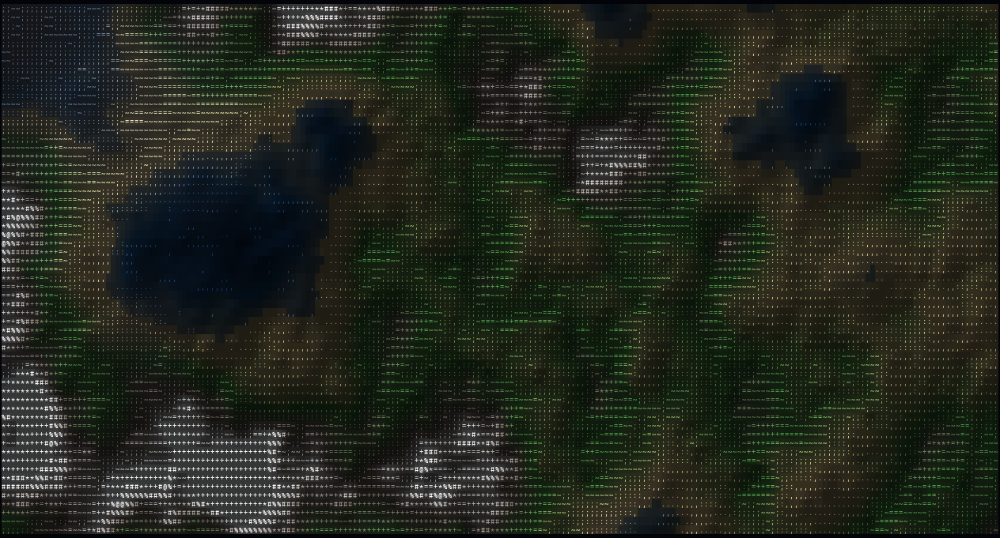
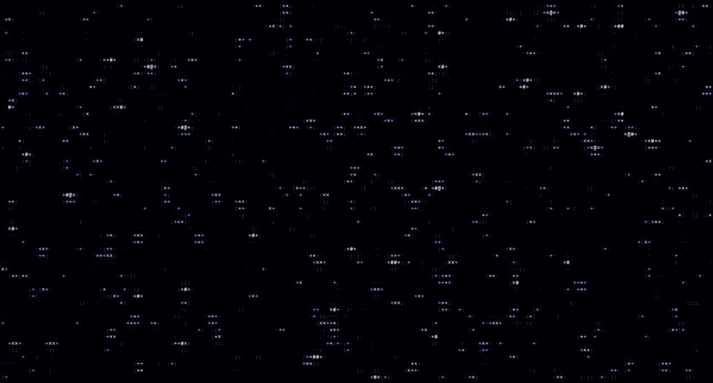

# AsciiPaper

**Wallpapers ASCII animados e interativos para Windows 10/11**, desenhados atrás dos ícones do ambiente de trabalho. Um único `.exe` nativo e pequeno (C++20, Win32, Direct3D 11), sem browser embutido nem runtime pesado. Cada wallpaper é programável e fácil de partilhar.

| ripple | matrix |
|---|---|
|  |  |
| **terrain** | **starfield** |
|  |  |

> **Estado: alpha (v0.2.0).** Fases 0–3 feitas: integração com o desktop, render ASCII, wallpapers em HLSL com hot reload, rato e quatro efeitos. Os wallpapers em Lua (fluid, particles, life, clock) chegam na Fase 4. Ver o [roadmap](#roadmap).

## Efeitos incluídos

| Wallpaper | Interação | Temas |
|---|---|---|
| **ripple** | o rato deixa ondas na água; clicar atira uma pedra; chove de vez em quando | `ember`, `blocks` |
| **matrix** | chuva de caracteres; as colunas desviam-se do cursor | `amber`, `binary` |
| **terrain** | paisagem de ruído a deslizar devagar; o rato faz parallax entre terra e nuvens | `desert`, `topo` |
| **starfield** | voo pelas estrelas; o rato define a direção | `warp`, `braille` |

Escolhe-os na tray → **Wallpaper**. A escolha fica guardada.

## O que a app faz por ti

- Fica **atrás dos ícones** no Windows 10, 11 e 11 24H2+; os ícones continuam clicáveis.
- **Vários monitores**, com DPIs diferentes e em coordenadas negativas. O texto é rasterizado no tamanho exato de cada monitor: nunca fica desfocado.
- **Pausa automática (0% de CPU)** por monitor: jogo ou vídeo em ecrã inteiro, janela maximizada, ecrã bloqueado, suspensão, poupança de bateria.
- **Só reage ao rato quando está sobre o desktop**: clicar num browser não faz ondas.
- Recupera sozinha se o **Explorer** reiniciar ou o **driver da GPU** reiniciar.
- **Ao sair, repõe o wallpaper original** do Windows.

Medido (Release, RTX 4060, 2 monitores 1080p a 60 fps): **0,17% de CPU**, 0,4 ms por frame, ~26 MB de RAM por monitor, primeiro frame em 240 ms, `.exe` de ~0,9 MB.

## Instalar e usar

1. Transfere o `AsciiPaper-<versão>-win64.zip` da página de [Releases](../../releases) e extrai-o para uma pasta.
2. Corre `asciipaper.exe`. O ícone aparece na área de notificação (junto ao relógio, talvez escondido na seta **^**).
3. Clica no ícone para escolher o wallpaper, pausar ou sair. Ao sair, o teu wallpaper original volta.

Não precisa de instalação nem de permissões de administrador. O Windows SmartScreen pode avisar, porque o executável ainda não está assinado.

### Linha de comandos

| Opção | Descrição |
|---|---|
| `--windowed` | Renderiza numa janela normal (para desenvolver sem mexer no desktop) |
| `--wallpaper <nome ou pasta>` | Usa um wallpaper (`ripple`, uma pasta, ou um tema `.toml`) |
| `--bench <segundos>` | Mede frame time médio/p99, CPU e RAM e sai |
| `--screenshot <ficheiro.png>` | Renderiza 3 s fora do ecrã, grava um PNG e sai |
| `--verbose`, `-v` | Logs detalhados, também na consola |
| `--help`, `-h` | Ajuda |

### Ficheiros

| Onde | O quê |
|---|---|
| `%APPDATA%\AsciiPaper\config.toml` | wallpaper escolhido, `interaction = "desktop_only" \| "always"`, `max_fps`, `pause_on_maximized`, `pause_on_battery_saver` |
| `%APPDATA%\AsciiPaper\wallpapers\` | os teus wallpapers (além dos que vêm ao lado do `.exe`) |
| `%APPDATA%\AsciiPaper\log.txt` | log (roda acima de 1 MB) |

## Criar o teu wallpaper

Uma pasta com um `wallpaper.toml` e um `main.hlsl` de poucas linhas:

```hlsl
CellOut cell(CellIn i)
{
    float d = cellDistance(i.pos, mouse.pos);
    float v = sin(d * 0.4 - time * 4.0 * param("speed")) * exp(-d * 0.05);
    CellOut o;
    o.value = v * 0.5 + 0.5;    // escolhe o caractere
    o.fg = palette(o.value);    // e a cor
    o.bg = float4(0, 0, 0, 0);
    o.state = float4(0, 0, 0, 0);
    o.glyph = 0;
    return o;
}
```

Guia completo, com a API toda e temas sem código: **[docs/CREATING_WALLPAPERS.md](docs/CREATING_WALLPAPERS.md)**. Com `--windowed --wallpaper <pasta>` tens hot reload: gravas e vês.

## Compilar a partir do código

Requisitos: **Windows 10/11 x64**, **Visual Studio 2022** com o workload *Desenvolvimento para desktop com C++* (MSVC v143 + Windows SDK) e **Git**.

```powershell
# 1. Ferramentas (CMake, Ninja, vcpkg) numa pasta do utilizador, sem admin
pwsh scripts/setup.ps1

# 2. Configurar, compilar e testar (Release por defeito)
pwsh scripts/build.ps1

# 3. Correr numa janela, com logs na consola
build\msvc\Release\asciipaper.exe --windowed --verbose

# 4. Criar o zip de release em dist/
pwsh scripts/package.ps1
```

Com CMake ≥ 3.25 e vcpkg já instalados, basta definir `VCPKG_ROOT` e usar os presets (`cmake --preset msvc`, `cmake --build --preset msvc-release`, `ctest --preset msvc-release`). As dependências (`wil`, `tomlplusplus`, `doctest`) vêm do vcpkg em modo manifest, compiladas estaticamente.

## Documentação

- [`PROJECT.md`](PROJECT.md) — a especificação completa (requisitos, formato dos wallpapers, fases, checklist de testes).
- [`docs/ARCHITECTURE.md`](docs/ARCHITECTURE.md) — como funciona por dentro e porquê: WorkerW, flip model, atlas de glifos, compute shader, DPI, pausas, loop sem polling.
- [`docs/CREATING_WALLPAPERS.md`](docs/CREATING_WALLPAPERS.md) — criar wallpapers e temas.
- [`CHANGELOG.md`](CHANGELOG.md) — histórico de versões.

## Roadmap

| Fase | Conteúdo | Estado |
|---|---|---|
| 0 — Esqueleto | CMake + vcpkg, manifesto PerMonitorV2, ícone, log, instância única, doctest | ✅ |
| 1 — Integração com o desktop | WorkerW (dois layouts), janela por monitor, D3D11 flip, DPI/monitores, reattach, pausas, repor wallpaper | ✅ código · ⏳ checklist manual |
| 2 — Render ASCII | GlyphAtlas (DirectWrite), cell buffer, `grid.hlsl`, blocos/caixa/Braille procedurais, `--bench` | ✅ · ⏳ teste a 200% |
| 3 — Input + backend shader | Raw Input, DesktopHitTest, `prelude.hlsl`, `prev()`, params, manifest TOML, hot reload, erros no ecrã; `ripple`, `matrix`, `terrain`, `starfield` | ✅ · ⏳ teste com o rato no desktop |
| 4 — Backend script | LuaJIT com sandbox, natives (fluid, particles, life); `fluid`, `particles`, `life`, `clock` | ⏳ |
| 5 — App e polimento | Config completa, wallpaper por monitor, autostart, tutorial | ⏳ (parte da tray e da config já existe) |

## Licença

[MIT](LICENSE).
